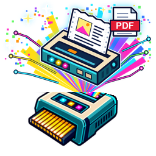
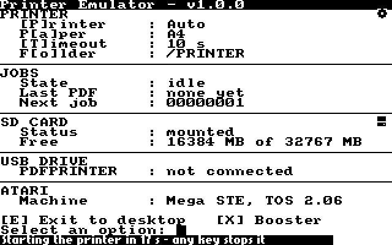
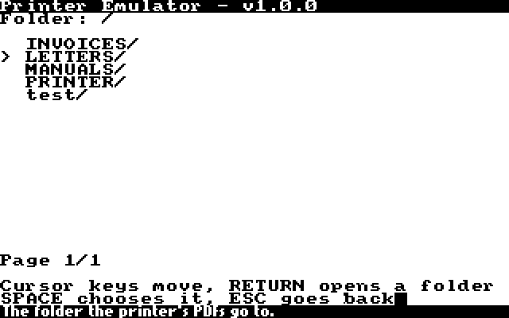
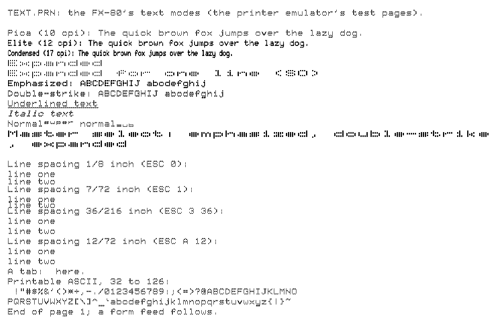
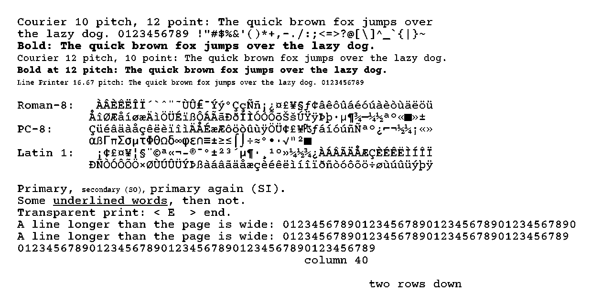
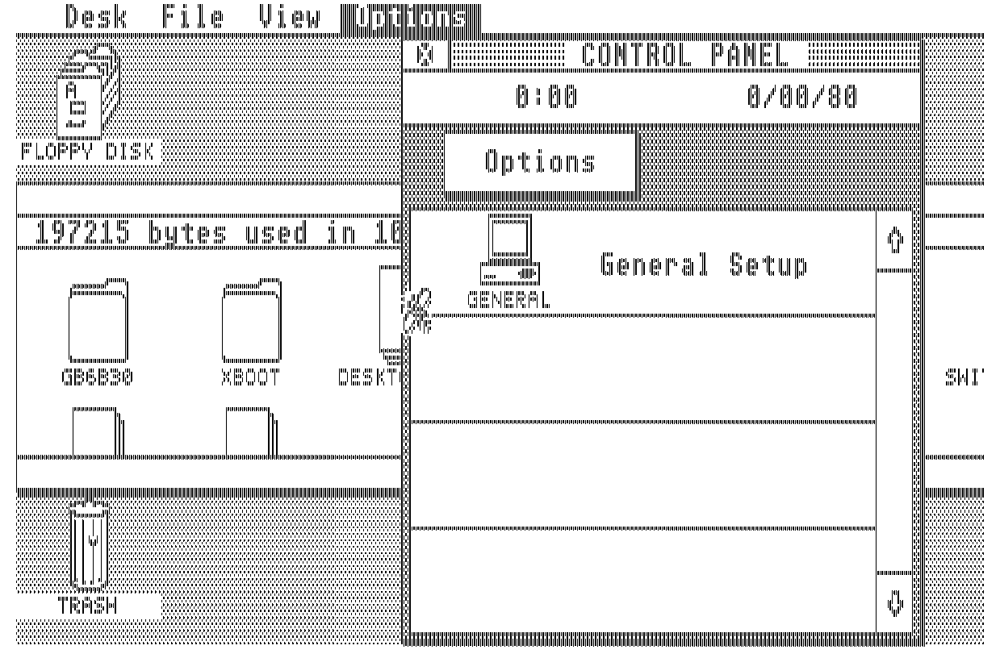

<div align="center">



# Printer Emulator

[](https://github.com/sidecartridge/md-printer-emulator/actions/workflows/build.yml)
[](https://github.com/sidecartridge/md-printer-emulator/actions/workflows/release.yml)
[](LICENSE)

</div>

A [SidecarTridge Multi-device](https://sidecartridge.com) microfirmware that
gives the **Atari ST, STE, Mega ST and Mega STE** a printer without a printer:
your programs print as if an **Epson FX-80** or an **HP LaserJet II** were
plugged into the printer port, and every page lands on the microSD card as a
**PDF**, ready to read on your computer over USB.

On a **Mega STE**, it keeps the speed and cache setting you chose: it prints at
8 MHz, at 16 MHz and with the cache on.

> Learn how to install and use it:
> <https://docs.sidecartridge.com/sidecartridge-multidevice/microfirmwares/printer-emulator/>

> 🛒 **Get the hardware:** [SidecarTridge Multi-device](https://sidecartridge.com/products/sidecartridge-multidevice-atari-st/)

## Installation

To install the Printer Emulator app on your SidecarTridge Multi-device:

1. Launch the **Booster App** on your SidecarTridge Multi-device.
2. Open the Booster web interface.
3. In the **Apps** tab, select **"Printer Emulator"** from the list of available apps.
4. Click **"Download"** to install the app to your SidecarTridge's microSD card.
5. Once installed, select the app and click **"Launch"** to activate it.

After launching, the app will automatically run every time your Atari computer is powered on.

## Usage

When you power on your Atari, the app displays its **setup screen**, with a
20-second countdown on its bottom line. When the countdown runs out, or when
you press **`E`**, the printer is installed and the Atari goes on to the
desktop. Press any other key to stop the countdown and change the settings.

From then on, the Atari prints as if a printer were plugged in: Alt-Help, the
desktop's **Print**, and every program that prints through TOS. Each print job
becomes one PDF on the microSD card.

Once the printer is installed, resetting the Atari brings it back to the
desktop with the printer installed again, without the setup screen. To see the
setup screen again, press **`SELECT`** on your Multi-device and then press the
reset button on your Atari, or power the Atari off and on.

On first use, the microfirmware creates the `/PRINTER` folder on the microSD
card for the PDFs. You can choose another folder from the setup screen.

## Setup screen



### Information on the setup screen

The setup screen shows the settings at the top and four live sections below
them, updated while the screen is up:

- **Jobs**: what the printer is doing (`idle`, `receiving` a job, `making` its
  PDF), the last PDF made and how many pages it has, and the number the next
  job will get.
- **SD card**: whether the card is mounted, and its free space.
- **USB drive**: whether a computer has the **PDFPRINTER** drive, and how many
  PDFs it shows.
- **Atari**: the machine and its TOS version. If it says `no hello (reset the
  ST)`, the Multi-device restarted without the Atari: reset the Atari before
  pressing `E`.

The bottom line shows the countdown, or `Countdown stopped: [E] starts the
printer.` once a key has stopped it.

### Printer settings

Every change is stored at once and used from the next job on.

- **`[P]rinter`** chooses the printer, one press at a time:
  - **Auto** (the default): each job goes to the printer it was written for.
    A job that starts with the LaserJet's commands (PCL) prints on the HP
    LaserJet II; everything else, plain text and Alt-Help included, prints on
    the Epson FX-80.
  - **Epson FX-80**: every job prints on the FX-80, a 9-pin dot-matrix
    printer, at its highest resolution (240 x 216 dots per inch). Characters
    128 to 255 print as the Atari's own characters, as on Atari's own
    printers.
  - **HP LaserJet II**: every job prints on the LaserJet, a 300 dots per inch
    laser printer that speaks PCL 4: its raster graphics, its built-in fonts
    (Courier 10 and 12 pitch, medium and bold, and Line Printer) and their
    character sets (Roman-8, PC-8, ISO Latin 1, ASCII).
- **`P[a]per`** toggles the paper between **A4** and **Letter**. The FX-80
  prints 70 lines a page on A4 and 66 on Letter, at 6 lines an inch.
- **`[T]imeout`** sets how long the Atari must stop printing before a job
  ends: 5, 10 (the default), 20, 30, 60 or 120 seconds, one press at a time.
  Everything printed until then goes into the same PDF, so a program that
  pauses between pages needs a longer timeout.
- **`F[o]lder`** opens the folder picker: the folder the PDFs go to.

### Choosing the folder



The picker lists the card's folders, one level at a time. The cursor keys
move, **`RETURN`** opens a folder (`..` goes up), **`SPACE`** chooses the
folder shown, and **`ESC`** goes back to the setup screen without a change.
Only folders that already exist on the card can be chosen, not the card's
root. The folder cannot change while a job is printing.

### Other setup screen commands

- **`[E] Exit to desktop`**: installs the printer and boots the Atari to the
  desktop.
- **`[X] Booster`**: goes back to the Booster app.

## Print jobs and PDFs

A job is everything the Atari prints until it has been quiet for the timeout,
or until it is reset. Each job gets the next number and becomes
`nnnnnnnn.pdf` in the folder: `00000001.pdf`, `00000002.pdf` and so on. The
numbers never repeat, even after a power cut: a number that is already on the
card is skipped.

While a job is printed and turned into a PDF you may see its working files in
the folder (`.TMP`, `.PRN`, `.PDT`). They become the PDF within seconds of the
job's end, and the PDFs are made in the order of the jobs, also after the
Multi-device starts again. A job that cannot be turned into a PDF keeps its
`.PRN` file, the bytes the Atari sent.

Each page of a PDF is one picture of the printed page, as the printer would
have printed it:







The Multi-device has no clock, so the files are dated 1 January 1970.

If the card is missing or full, the Atari keeps printing as if nothing
happened, but the job is lost: the setup screen says so in **Jobs**
(`lost: card full` or `lost: card failed`), and a job the card could not take
is deleted.

## Getting the PDFs: the PDFPRINTER drive

Connect the Multi-device's micro-USB port (on its Raspberry Pi Pico W) to your
computer while the app runs: a drive named **PDFPRINTER** appears with the
folder's PDFs, and nothing else. It is read-only: you can open and copy the
PDFs, but not change or delete them.

A PDF printed while the drive is connected appears on its own: the drive
disappears for about five seconds and comes back with the new PDF (on a Mac,
about eight seconds after the PDF is made).

To delete PDFs, or to read the working files, take the microSD card out and
read it in your computer.

## Setting up your programs

The Atari does not know which printer is plugged in: each program sends its
own printer's commands. Choose the driver for the printer you want, and leave
`[P]rinter` on Auto, or set it to that printer.

### Alt-Help and the desktop

- **Alt-Help** (the screen dump) only speaks the Atari and Epson dot-matrix
  printers' commands: leave `[P]rinter` on Auto or the FX-80. On a forced HP
  LaserJet II it prints pages of garbage, as a real LaserJet would.
- The desktop's **Install Printer** (or XControl's printer settings) changes
  how Alt-Help prints, for example Draft or Final. Keep the port on
  **Printer**.
- The desktop's **Print** of a text file prints it as it is, on the FX-80.

### GDOS programs (Easy Draw, GEM Output, Timeworks Publisher)

GDOS reads the printer driver and its fonts from `ASSIGN.SYS`, as device 21.
The fonts must be the ones made for that printer's resolution: without them
GDOS prints the drawings but leaves the text out.

For the Epson FX-80, Atari's FX-80 driver with its FX-80 fonts (Atari's "GDOS
Fonts and Drivers for Epson FX-80" disk):

```
21 FX80.SYS
EPSHSS07.FNT
ATSS10EP.FNT
ATSS12EP.FNT
ATSS18EP.FNT
ATSS24EP.FNT
ATTR10EP.FNT
ATTR12EP.FNT
ATTR18EP.FNT
ATTR24EP.FNT
ATTP10EP.FNT
```

For the HP LaserJet II, a GDOS LaserJet driver with fonts for 300 dots per
inch, for example the ones that come with Timeworks Publisher:

```
21 HP_LJET.SYS
HPSS07AS.FNT
HPSS10AS.FNT
HPSS12AS.FNT
HPSS14AS.FNT
HPSS24AS.FNT
HPTR07AS.FNT
HPTR10AS.FNT
HPTR12AS.FNT
HPTR14AS.FNT
HPTR24AS.FNT
```

List only the fonts that are in your `GEMSYS` folder.

### Programs with their own printer drivers

| Program | Epson FX-80 | HP LaserJet II |
| --- | --- | --- |
| 1st Word Plus | `PRINTERS\EPSON_FX.CFG` as the printer | `PRINTERS\STANDARD.CFG`, with `[P]rinter` on HP LaserJet II (on Auto, plain text goes to the FX-80): plain text in Courier, without bold, underline, pictures or accented letters |
| ST Writer Elite | prints as it is | – |
| Degas Elite | `PRINTERS\EPSON.PRT` (File > Print type) | – |
| GFA BASIC | `LPRINT` and `HARDCOPY` | – |

A program with an Epson FX-80, Epson 9-pin or Atari dot-matrix (SMM804)
driver prints on the FX-80; one with an HP LaserJet, LaserJet Plus or
LaserJet II driver prints on the LaserJet.

## Tested programs

| Program | Printer |
| --- | --- |
| Alt-Help, in low, medium and high resolution | FX-80 |
| The desktop's Print of a text file | FX-80 |
| Install Printer and XControl's printer settings, with Alt-Help | FX-80 |
| 1st Word Plus 2.02 | FX-80 |
| ST Writer Elite 4.0 | FX-80 |
| Degas Elite 1.0 | FX-80 |
| GFA BASIC 3.5: `LPRINT` and `HARDCOPY` | FX-80 |
| Easy Draw 2.35 and its Outprint, through GDOS | FX-80 and LaserJet |

## Known issues

- Programs that drive the printer port's hardware themselves, instead of
  printing through TOS, are not caught: nothing reaches the card. Calamus 1.x
  is one, and so is Signum 3 with its default output channel,
  "Centronics schnell". Signum 3's "Centronics, BIOS" channel does reach the
  card, but Signum 3 only has 24-pin drivers, which the FX-80 does not
  understand.
- The LaserJet prints every page in portrait, on the paper of `P[a]per`, and
  does not draw PCL's filled rectangles.
- The PDFPRINTER drive has been tested with macOS only.
- The files are dated 1 January 1970.

## System reset behavior

Resetting the Atari ends the job being printed, and the printer is installed
again before the desktop starts. The setup screen only shows after a power
cycle, or after a press on **`SELECT`**.

Holding **`SELECT`** for **10 seconds** is a factory reset of the
Multi-device: every setting, of this app and of the others, goes back to its
default, and the Multi-device starts Booster.

## Power cycling

When you power the Atari off, a job that has not ended yet is kept: it becomes
a PDF the next time the Multi-device starts. The next job numbers carry on
from where they were.

## Building

```bash
# ./build.sh <board_type> <build_type> <app_uuid>
./build.sh pico_w release 44444444-4444-4444-8444-444444444444
```

The build needs the ARM GNU Toolchain 14.2 (`PICO_TOOLCHAIN_PATH`) and the
[atarist-toolkit-docker](https://github.com/sidecartridge/atarist-toolkit-docker)
(`stcmd`) for the Atari side. It leaves the UF2 and the app's descriptor in
`dist/`. The general instructions are in the
[official documentation](https://docs.sidecartridge.com/sidecartridge-multidevice/programming/).

## Tests

- `tools/printer/test.sh`: the printers on the computer: our own printer
  streams rendered, page by page, against their reference pages, and each PDF
  checked.
- `tools/pdfvol/test.sh`: the PDFPRINTER drive as a disk image, checked and
  mounted.
- `tools/dev/emu_harness.py`: the whole firmware in an emulated ST, STE or
  Mega STE (see `emu/README.md`).
- `tools/dev/`: the tools for the device, through a Raspberry Pi Debug Probe
  (see `tools/dev/README.md`).

## Project docs

- `CLAUDE.md` / `AGENTS.md`: build, architecture, and contributor playbook.
- `programming.md`: the shared cartridge region and its budget rules.

## License

Licensed under the GNU General Public License v3.0. See [LICENSE](LICENSE).

The HP LaserJet II's fonts are drawn from Courier Prime (SIL Open Font
License, [`rp/src/pcl/OFL.txt`](rp/src/pcl/OFL.txt)) and DejaVu Sans Mono
([`rp/src/pcl/DEJAVU-LICENSE.txt`](rp/src/pcl/DEJAVU-LICENSE.txt)).

## Contributing

Made with ❤️ by [SidecarTridge](https://sidecartridge.com)
